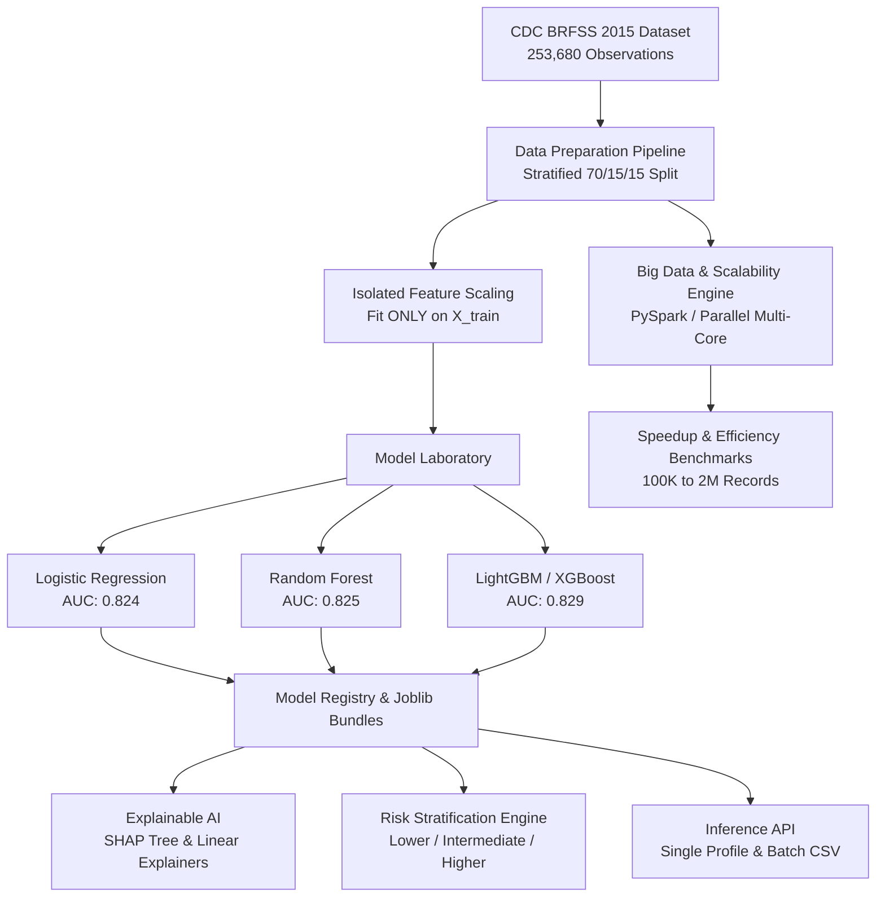

# DiaRisk Analytics: Explainable Diabetes Risk Intelligence

> **A Scalable and Explainable Cloud-Based Big Data Analytics Framework for Diabetes Risk Prediction and High-Risk Patient Stratification**

[](https://fastapi.tiangolo.com/)
[](https://react.dev/)
[](https://vitejs.dev/)
[](https://scikit-learn.org/)
[](https://lightgbm.readthedocs.io/)
[](https://shap.readthedocs.io/)
[]()

---

## 1. Project Overview & Research Mission

**DiaRisk Analytics** is an end-to-end cloud-ready research application designed to ingest large-scale population health data, prevent methodological data leakage, train high-accuracy calibrated classification models, provide transparent cooperative-game-theory explanations (SHAP), stratify populations into 3 actionable empirical risk tiers, and benchmark parallel computing performance across workloads of up to 2,000,000 observations.

### Research Scope & Clinical Boundaries
- **Empirical Basis**: Analyzes the CDC Behavioral Risk Factor Surveillance System (BRFSS 2015), representing **253,680 survey participants** across 21 clinical, behavioral, and demographic features.
- **Cross-Sectional Outcome**: The primary target variable (`Diabetes_binary`) represents survey-recorded diabetes status at the time of interview. In accordance with epidemiological standards, this framework does not claim prospective prediction of future disease onset.
- **Mandatory Medical Disclaimer**: *Research estimate only. This model does not provide a medical diagnosis. Results may be inaccurate and should not replace professional medical assessment or appropriate clinical testing.*

---

## 2. System Architecture



---

## 3. Dataset Configuration & Roles

The dataset files reside directly in `dataset/` and are resolved using project-relative path calculations:

| File Name | Records | Dimensions | Role | Target Column |
| :--- | :---: | :---: | :--- | :--- |
| `diabetes_binary_health_indicators_BRFSS2015.csv` | **253,680** | 22 cols | **Primary Classification Dataset** | `Diabetes_binary` (0: 86.1%, 1: 13.9%) |
| `diabetes_012_health_indicators_BRFSS2015.csv` | **253,680** | 22 cols | Multi-Class Progression Experiment | `Diabetes_012` (0=No, 1=Pre, 2=Diabetic) |
| `diabetes_binary_5050split_health_indicators_BRFSS2015.csv` | **70,692** | 22 cols | Class Balance Sensitivity Analysis | `Diabetes_binary` (50% / 50%) |

### Duplicate Handling Rationale
The primary dataset contains **24,206 identical rows**. In the BRFSS population health survey, all 21 features are recorded as discrete integer-coded survey responses (e.g., biological sex, categorical age brackets, self-rated general health). Identical answer profiles reflect real independent respondents who gave identical responses, not data entry errors. Therefore, rows are retained by default to maintain natural population proportions.

---

## 4. UI Design & Strict Healthcare Palette

The frontend interface adheres strictly to a clean, light healthcare SaaS aesthetic with dominant white backgrounds and subtle muted red-pink accents:

- **Main Background**: `#FFFFFF`
- **Secondary Background**: `#FFF8FA`
- **Card Background**: `#FFFFFF`
- **Primary Text**: `#29252B`
- **Secondary Text**: `#77717A`
- **Primary Accent**: `#C84B65`
- **Soft Accent Pink**: `#E8A1B1`
- **Pale Pink Surface**: `#FBEAF0`
- **Pale Red Surface**: `#FCE8E8`
- **Border**: `#F0E4E8`
- **Success / Protective**: `#47866C`
- **Warning**: `#C58B38`
- **Error / High Risk**: `#C74650`

---

## 5. Local Quickstart Instructions

### Prerequisites
- Python 3.10+
- Node.js 18+ (tested on Node v24)
- (Optional) Java 11 or 17 for PySpark local JVM

### Step 1: Backend Setup
```bash
# Navigate to backend directory
cd backend

# Install Python dependencies
pip install -r requirements.txt

# Run FastAPI server with hot-reload
python -m uvicorn app.main:app --host 0.0.0.0 --port 8000
```
Backend API will be accessible at: `http://localhost:8000`
Interactive Swagger Docs: `http://localhost:8000/docs`

### Step 2: Frontend Setup
```bash
# Open a new terminal and navigate to frontend directory
cd frontend

# Install Node dependencies (if not already installed)
npm install

# Start Vite development server
npm run dev
```
Frontend will be accessible at: `http://localhost:5173`

---

## 6. Docker & Containerized Deployment

To launch the full application with containerized PySpark and OpenJDK 17:

```bash
# From the project root
docker-compose up --build
```
- **Frontend SPA**: `http://localhost:3000`
- **Backend API**: `http://localhost:8000`

---

## 7. Automated Testing

To run the verification test suite:
```bash
cd backend
python -m pytest app/tests/test_ml.py -v
```
All unit tests validate dataset integrity, leakage-free scaling, training convergence, SHAP calculation, and risk stratification.

---

## 8. API Reference

| Method | Endpoint | Description |
| :--- | :--- | :--- |
| `GET` | `/api/health` | System status, path resolution, and dataset existence check |
| `GET` | `/api/datasets` | List available BRFSS dataset variants |
| `GET` | `/api/datasets/{id}/summary` | Record count, feature count, duplicate statistics, and target ratios |
| `GET` | `/api/datasets/{id}/schema` | Feature data types, statistical moments (mean, std, min, median, max) |
| `GET` | `/api/datasets/{id}/correlations` | Pearson feature-target correlation coefficients and top matrix |
| `GET` | `/api/datasets/{id}/distribution` | Stratified outcome prevalence histogram for selected feature |
| `POST` | `/api/preprocessing/run` | Leakage-free train/val/test split and Apache Parquet export |
| `POST` | `/api/training/start` | Async background training job for LR, RF, LightGBM, or XGBoost |
| `GET` | `/api/training/{job_id}` | Real-time progress percentage and logs |
| `GET` | `/api/models` | Model leaderboard comparison |
| `GET` | `/api/models/{id}/metrics` | ROC-AUC, PR-AUC, calibration curve, confusion matrix |
| `POST` | `/api/predictions/single` | Clinical profile evaluation and 3-tier risk assignment |
| `POST` | `/api/predictions/batch` | Multi-record CSV cohort prediction with validation |
| `POST` | `/api/explanations/global` | Population-level mean absolute SHAP feature attributions |
| `POST` | `/api/explanations/local` | Single patient prediction waterfall breakdown |
| `GET` | `/api/stratification/summary` | 3-tier risk bands with Wilson score 95% confidence intervals |
| `POST` | `/api/benchmarks/start` | Scalability benchmark comparing single-core vs multi-core pipeline |
| `GET` | `/api/benchmarks/spark-status` | PySpark environment diagnostics and setup guidance |
| `GET` | `/api/reports/generate` | Comprehensive technical research report |

---

## 9. Ethical & Clinical Disclaimers

> **RESEARCH USE ONLY**
>
> 1. **No Autonomous Diagnosis**: This software does not provide medical diagnoses, treatment suggestions, or prescriptive healthcare orders.
> 2. **Survey Limitations**: BRFSS is an observational self-reported telephone survey conducted by the CDC. Responses may be subject to recall bias.
> 3. **Explainability vs Causation**: SHAP values explain statistical associations within the trained models. They do not constitute biochemical or physiological causation.
